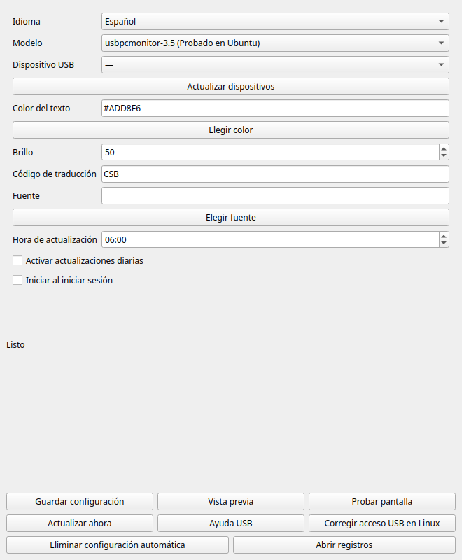

[English](README.md) · [简体中文](README.zh-CN.md) · [Español](README.es.md) · [Français](README.fr.md)


# Bible Smart Display

**Un versículo cada día en tu escritorio.**

Para una **Turing Smart Screen de 3,5 pulgadas o una pantalla USB similar**.

También se venden como **“IPS secondary screen” (pantalla secundaria IPS)** en AliExpress y otras tiendas. Ese nombre comercial no garantiza la compatibilidad; consulta la tabla de modelos que aparece más abajo.

[Descargar la aplicación](https://github.com/dgcarr/bibleSmartDisplay/releases/latest) · [Estado de compilación](https://github.com/dgcarr/bibleSmartDisplay/actions/workflows/desktop.yml) · [GPL v3](LICENSE)

**Traducción a elegir · Texto azul claro · Brillo ajustable · Restauración sin conexión**

La aplicación obtiene la [referencia diaria de Bible League](https://www.bibleleague.org/verse-of-the-day/), busca el pasaje en Bible Gateway con la traducción elegida (**CSB** por defecto) y lo muestra en la pantalla. El tamaño del texto se adapta al espacio disponible.

## La forma más sencilla: descarga la aplicación

**Recomendado para casi todos. Descarga la aplicación lista para usar: sin instalar Python, Git ni configurar una terminal.**

### [⬇ Abrir la última versión →](https://github.com/dgcarr/bibleSmartDisplay/releases/latest)

| Tu equipo | Archivo para descargar | Instalación |
| :--- | :--- | :--- |
| Windows 10/11 · x64 | `bibleSmartDisplay-windows-x64-setup.exe` | Ejecuta el instalador |
| macOS 13+ · Apple Silicon | `bibleSmartDisplay-macos-arm64.dmg` | Abre el DMG y arrastra la app a Aplicaciones |
| macOS 13+ · Intel | `bibleSmartDisplay-macos-x64.dmg` | Abre el DMG y arrastra la app a Aplicaciones |
| Debian / Ubuntu · Intel/AMD | `biblesmartdisplay_0.4.4_amd64.deb` | Abre con el instalador de software |
| Raspberry Pi OS / Debian / Ubuntu · ARM64 | `biblesmartdisplay_0.4.4_arm64.deb` | Abre con el instalador de software |
| Otros escritorios Linux | `bibleSmartDisplay-linux-x64.tar.gz` / `bibleSmartDisplay-linux-arm64.tar.gz` | Extrae y abre el ejecutable |

## Configura la pantalla

1. Conecta la pantalla con un **cable USB de datos** y cierra el software del fabricante.
2. Abre **Bible Smart Display** desde el menú de aplicaciones. Sigue el asistente para elegir modelo y puerto USB, color y traducción bíblica, y enviar una imagen de prueba.
3. Elige si quieres activar las **actualizaciones diarias** y el **inicio de la app al iniciar sesión**, y termina la configuración. Pulsa **Actualizar ahora** para obtener el primer versículo.

**¡Ya está instalada! No necesitas seguir las instrucciones de instalación desde el código fuente.**

## Ajustes cotidianos

Usa el icono de la bandeja o barra de menús para cambiar modelo, color, brillo, traducción, fuente o idioma. Incluye inglés, chino simplificado, español y francés. La programación diaria y el inicio al iniciar sesión tienen casillas independientes. Al salir de la app, las actualizaciones programadas siguen funcionando durante tu sesión.

El texto usa **supermuestreo 3×** para suavizar los bordes manteniendo el estilo de letra ligero. Se aplica a la aplicación, las vistas previas y las actualizaciones programadas de todos los modelos compatibles.

<details>
<summary>Captura de la aplicación</summary>



</details>

[Guía, solución de problemas y desinstalación (inglés)](docs/desktop.md) · [Informar de un problema](https://github.com/dgcarr/bibleSmartDisplay/issues)

Requiere un sistema de escritorio compatible. Los paquetes no tienen firma de editor ni notarización de Apple; consulta los requisitos en la [guía](docs/desktop.md). Antes de desinstalar, selecciona **Eliminar configuración automática** y cierra la app.

## Elige el modelo de pantalla

| Opción de modelo | Pantalla | Resolución horizontal | Estado |
| :--- | :--- | :--- | :--- |
| `usbpcmonitor-3.5` | UsbPCMonitor / compatible 3.5-inch | 480 × 320 | Probado en Ubuntu; predeterminado |
| `turing-3.5` | Original Turing 3.5-inch | 480 × 320 | Experimental |
| `usbpcmonitor-5` | UsbPCMonitor 5-inch | 800 × 480 | Experimental |
| `usbpcmonitor-7` | UsbPCMonitor 7-inch | 1024 × 600 | Experimental |
| `xuanfang-3.5` | XuanFang Revision B / flagship | 480 × 320 | Experimental |
| `qiye-3.5` | Kipye / Qiye / 奇叶智显 (Revision D) | 480 × 320 | Experimental |

Elige el modelo y el puerto exactos. **Experimental** significa que está implementado y tiene pruebas de comunicación simulada, pero no se ha probado con ese hardware físico en este proyecto.

**No admitidos:** AX206/AIDA64/USB2LCD, Turing de 5 pulgadas Revision C, pantallas redondas, Waveshare USB-Monitor, GUITION, Fuldho/SmartMonitor y HDMI. AX206 necesita un controlador de comunicación USB directa independiente. UsbPCMonitor de 5 pulgadas y Turing de 5 pulgadas usan protocolos distintos.

## Controladores USB

**Si la pantalla ya aparece como puerto serie, pruébala antes de instalar otro controlador.**

| Dispositivo / sistema | Recurso oficial |
| :--- | :--- |
| Pantalla Turing/TURZX | [Descargas del fabricante](https://www.turzx.com/en/category/download/): elige tu modelo exacto |
| Dispositivo USB CDC en Windows | [Controlador serie integrado de Microsoft](https://learn.microsoft.com/en-us/windows-hardware/drivers/usbcon/usb-driver-installation-based-on-compatible-ids): instalación automática para dispositivos compatibles |
| Windows, chip CH340/CH341 confirmado | [Controlador WCH para Windows](https://www.wch.cn/downloads/CH341SER_EXE.html) |
| macOS, chip serie WCH compatible | [Controlador WCH para Mac e instrucciones](https://github.com/WCHSoftGroup/ch34xser_macos) |
| Linux | Los dispositivos compatibles suelen usar los controladores del kernel |

Los controladores WCH **no son universales para todas las pantallas**. En Windows, abre **Administrador de dispositivos → Puertos (COM y LPT)**. Si hay una advertencia, consulta **Propiedades → Detalles → Id. de hardware** para elegir el controlador correcto. [Guía completa (en inglés)](docs/setup.md#windows-usb-drivers)

---

<details>
<summary><strong>Opcional: código fuente y herramientas de terminal (usuarios avanzados)</strong></summary>

**Solo para desarrolladores y aficionados. Es una alternativa a la aplicación descargada, no el siguiente paso de instalación.** Los comandos siguientes ejecutan la edición independiente de terminal. Puedes ignorar toda esta sección si utilizas la aplicación de escritorio.

[Desktop app source / GUI](docs/desktop.md#build-from-source) · [CLI / Python](docs/setup.md#install-from-source-all-three-desktop-operating-systems)

Necesitas la pantalla, un **cable USB de datos** y conexión a internet. Cierra el programa del fabricante antes de comenzar.

## Windows: tres pasos

1. Abre la [última versión](https://github.com/dgcarr/bibleSmartDisplay/releases/latest). En **Assets**, descarga `bibleSmartDisplay-windows-x64.zip`, no el ZIP del código fuente.
2. Extrae el ZIP en una carpeta propia, como `Documents\bibleSmartDisplay`, y conecta la pantalla por su puerto de datos.
3. Haz doble clic en **`Run-display.cmd`**. La aplicación actualiza la pantalla una vez y termina; la consola queda abierta para mostrar los mensajes.

<details>
<summary><strong>¿No encuentra la pantalla? Elige el puerto COM</strong></summary>

Abre PowerShell en la carpeta extraída:

```powershell
.\bibleSmartDisplay.exe --list-ports
.\bibleSmartDisplay.exe --port COM3
```

Sustituye `COM3` por el puerto de tu pantalla. Si no aparece ningún puerto, consulta los controladores más abajo.

</details>

<details>
<summary><strong>Prueba sin pantalla ni conexión a internet</strong></summary>

```powershell
.\bibleSmartDisplay.exe --demo --preview-only
```

Abre `%LOCALAPPDATA%\bibleSmartDisplay\preview.png` para ver la imagen de prueba.

</details>

> [!NOTE]
> Es una aplicación portátil de consola, no un instalador gráfico. El ejecutable no está firmado. Las pruebas automáticas de Windows y de vista previa pasan; falta comprobar el USB con pantallas físicas en Windows/macOS. La salida física se ha probado en Ubuntu.

## Linux

Instala Python 3.10+, Git, soporte para venv y DejaVu Sans. En Ubuntu/Debian/Raspberry Pi OS, los paquetes son `python3`, `python3-venv`, `python3-pip`, `git` y `fonts-dejavu-core`.

```sh
git clone https://github.com/dgcarr/bibleSmartDisplay.git
cd bibleSmartDisplay
python3 -m venv .venv
.venv/bin/python -m pip install -r requirements.txt
.venv/bin/python outputs/daily-verse/verse_display.py
```

Si falla la detección, añade `--list-ports` y después `--port /dev/ttyACM0`, con tu puerto real. [Permisos del puerto serie (en inglés)](docs/setup.md#linux-including-raspberry-pi-os)

## macOS

Instala [Python 3.10+](https://www.python.org/downloads/macos/). Descarga este repositorio con **Code → Download ZIP**, extráelo y abre Terminal en la carpeta que contiene `requirements.txt`:

```sh
python3 -m venv .venv
.venv/bin/python -m pip install -r requirements.txt
.venv/bin/python outputs/daily-verse/verse_display.py
```

Si falla la detección, usa `--list-ports` y después `--port /dev/cu.usbmodem1234`, sustituyendo el ejemplo por tu puerto. [Ayuda para macOS (en inglés)](docs/setup.md#macos)

## Elige una traducción

Usa un [código de versión de Bible Gateway](https://www.biblegateway.com/versions/). Por ejemplo, `RVR1960` para Reina-Valera 1960:

```powershell
.\bibleSmartDisplay.exe --translation RVR1960
.\bibleSmartDisplay.exe --translation NIV
```

En Linux/macOS:

```sh
.venv/bin/python outputs/daily-verse/verse_display.py --translation RVR1960
```

La opción predeterminada sigue siendo CSB. Puedes solicitar un código de versión de texto, siempre que el pasaje exista en esa versión. No se admiten versiones disponibles únicamente en PDF o audio. Algunos idiomas necesitan `--font` con una fuente adecuada; las escrituras complejas y los pasajes largos sin espacios no están completamente probados.

Para conservar tu elección, añade el argumento a la tarea programada o edita la línea que ejecuta el programa en `Run-display.cmd`. `--cached` restaura la última traducción guardada; añade `--translation RVR1960` para exigir esa versión. Si falla la consulta, no se sustituye silenciosamente por otra traducción. La caché conserva un solo pasaje.

## Personaliza la pantalla

Los valores iniciales son **texto azul claro y brillo al 50 %**:

```powershell
.\bibleSmartDisplay.exe --color "#ADD8E6" --brightness 50
```

En Linux/macOS, añade los mismos argumentos después de `.venv/bin/python outputs/daily-verse/verse_display.py`.

| Opción | Función |
| :--- | :--- |
| `--brightness 25` | Ajustar la retroiluminación entre 0 y 100 |
| `--color "#F5F5DC"` | Usar texto beige |
| `--cached` | Restaurar el último pasaje sin conexión |
| `--preview-only` | Guardar una vista previa sin enviarla a la pantalla |
| `--list-ports` | Mostrar los dispositivos serie |

Las opciones solo se aplican a esa ejecución. Inclúyelas en tu tarea programada para repetirlas cada día. [Ajustes y archivos guardados (en inglés)](docs/setup.md#commands-and-settings)

## Actualiza cada mañana

La aplicación se ejecuta una vez y termina. Configura el programador de tu sistema para actualizarla diariamente:

[Programador de tareas de Windows (en inglés)](docs/setup.md#windows-task-scheduler) · [Cron en Linux (en inglés)](docs/setup.md#linux-cron) · [Launchd en macOS (en inglés)](docs/setup.md#macos-launchd)

El ordenador debe estar encendido y la pantalla conectada. La primera descarga requiere internet; si después falla la red, puede usarse el pasaje guardado de la misma traducción. La caché se sobrescribe y no crece indefinidamente.

## ¿Necesitas ayuda?

| Problema | Primera comprobación |
| :--- | :--- |
| No se encuentra la pantalla | Cable de datos, `--list-ports` y controladores |
| Puerto ocupado | Cierra el programa del fabricante y otras instancias |
| Error de comunicación o imagen desordenada | Comprueba el modelo, la resolución y el protocolo |
| No hay pasaje guardado | Ejecuta una vez con internet y sin `--cached` |
| La ventana se cierra | Usa `Run-display.cmd` o ejecuta desde una terminal |

[Solución de problemas (en inglés)](docs/setup.md#troubleshooting) · [Informar de un problema](https://github.com/dgcarr/bibleSmartDisplay/issues) · [Compilar desde el código fuente (en inglés)](docs/setup.md#build-the-windows-executable-yourself)

Incluye tu sistema operativo, modelo de pantalla, identificadores de hardware y mensaje de error.

</details>

### Créditos y licencia

Basado en la documentación del protocolo de [turing-smart-screen-python](https://github.com/mathoudebine/turing-smart-screen-python), de Matthieu Houdebine y sus colaboradores. Proyecto independiente de los fabricantes. Software bajo **[GPL v3](LICENSE)**; los archivos originales conservan sus avisos.

Referencia diaria: [Bible League](https://www.bibleleague.org/verse-of-the-day/). Texto bíblico: [Bible Gateway](https://www.biblegateway.com/). Versión predeterminada: Christian Standard Bible © 2017 Holman Bible Publishers. Las demás traducciones pertenecen a sus respectivos titulares; el texto bíblico no está cubierto por la licencia del software.
