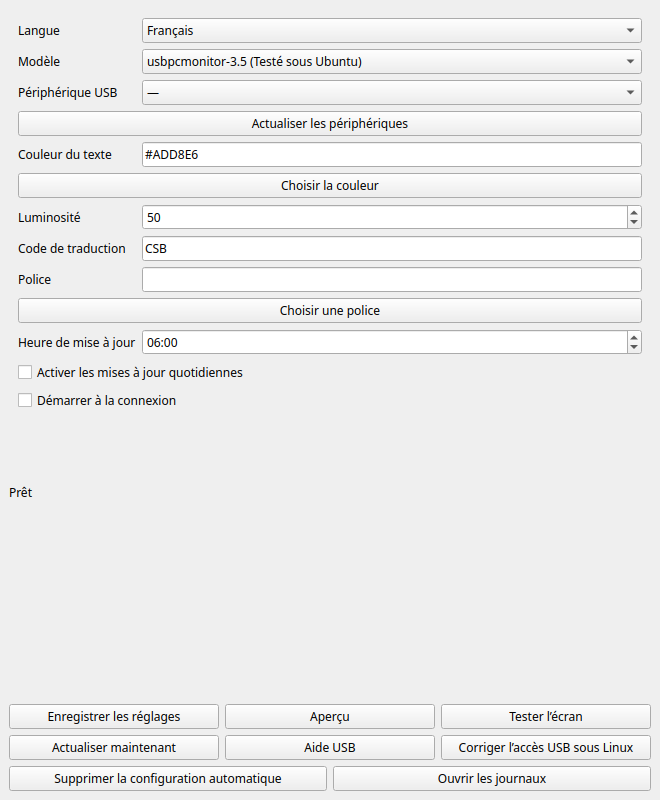

[English](README.md) · [简体中文](README.zh-CN.md) · [Español](README.es.md) · [Français](README.fr.md)


# Bible Smart Display

**Un verset biblique chaque jour sur votre bureau.**

Pour un **Turing Smart Screen de 3,5 pouces ou un écran USB similaire**.

Ces appareils sont aussi vendus sous le nom **« IPS secondary screen » (écran secondaire IPS)**, notamment sur AliExpress. Cette appellation ne garantit pas la compatibilité : consultez le tableau des modèles ci-dessous.

[Télécharger pour Windows](https://github.com/dgcarr/bibleSmartDisplay/releases/latest) · [État de la compilation](https://github.com/dgcarr/bibleSmartDisplay/actions/workflows/windows.yml) · [GPL v3](LICENSE)

**Traduction au choix · Texte bleu clair · Luminosité réglable · Restauration hors ligne**

L’application récupère la [référence quotidienne de Bible League](https://www.bibleleague.org/verse-of-the-day/), cherche le passage sur Bible Gateway dans la traduction choisie (**CSB** par défaut), puis l’affiche sur votre écran. La taille du texte s’adapte à l’espace disponible.

## Choisir le modèle d’écran

| Option du modèle | Écran | Résolution paysage | État |
| :--- | :--- | :--- | :--- |
| `usbpcmonitor-3.5` | UsbPCMonitor / compatible 3.5-inch | 480 × 320 | Testé sous Ubuntu ; par défaut |
| `turing-3.5` | Original Turing 3.5-inch | 480 × 320 | Expérimental |
| `usbpcmonitor-5` | UsbPCMonitor 5-inch | 800 × 480 | Expérimental |
| `usbpcmonitor-7` | UsbPCMonitor 7-inch | 1024 × 600 | Expérimental |
| `xuanfang-3.5` | XuanFang Revision B / flagship | 480 × 320 | Expérimental |
| `qiye-3.5` | Kipye / Qiye / 奇叶智显 (Revision D) | 480 × 320 | Expérimental |

Sélectionnez le modèle et le port exacts. **Expérimental** signifie que le protocole est implémenté et testé avec une liaison série simulée, mais pas encore avec le matériel physique dans ce projet.

```powershell
.\bibleSmartDisplay.exe --list-models
.\bibleSmartDisplay.exe --model xuanfang-3.5 --port COM3
.\bibleSmartDisplay.exe --model turing-3.5 --port COM3
```

Sous Linux/macOS, ajoutez les mêmes options après `.venv/bin/python outputs/daily-verse/verse_display.py`. Les modèles expérimentaux exigent un `--port` explicite. Utilisez `--demo --preview-only` pour vérifier la mise en page sans matériel.

Seul `turing-3.5`, choisi explicitement, accepte une réponse HELLO vide. UsbPCMonitor exige la réponse correspondant à sa taille. Ne choisissez pas Turing original pour contourner une erreur. Certaines révisions XuanFang permettent seulement d’allumer ou d’éteindre le rétroéclairage ; l’éclairage RGB arrière n’est pas configuré. Qiye ne dispose pas d’une vérification d’identité : sélectionnez le bon appareil.

**Non pris en charge :** AX206/AIDA64/USB2LCD, Turing 5 pouces Revision C, écrans ronds, Waveshare USB-Monitor, GUITION, Fuldho/SmartMonitor et HDMI. AX206 nécessite un backend USB direct distinct. UsbPCMonitor 5 pouces et Turing 5 pouces utilisent des protocoles différents.

## Choisir l’installation

| Système | Installation |
| :--- | :--- |
| Windows 10/11 x64 | Application portable, sans installer Python |
| Linux / Raspberry Pi OS | Code source avec Python 3.10 ou ultérieur |
| macOS | Code source avec Python 3.10 ou ultérieur |

Préparez votre écran, un **câble USB permettant le transfert de données** et une connexion internet. Fermez le logiciel du fabricant avant de commencer.

## Windows : trois étapes

1. Ouvrez la [dernière version](https://github.com/dgcarr/bibleSmartDisplay/releases/latest). Sous **Assets**, téléchargez `bibleSmartDisplay-windows-x64.zip`, et non l’archive du code source.
2. Extrayez le ZIP dans votre dossier, par exemple `Documents\bibleSmartDisplay`, puis branchez l’écran sur son port de données.
3. Double-cliquez sur **`Run-display.cmd`**. L’application actualise l’écran une fois, puis se termine. La console reste ouverte pour afficher les messages.

<details>
<summary><strong>Écran introuvable ? Choisissez son port COM</strong></summary>

Ouvrez PowerShell dans le dossier extrait :

```powershell
.\bibleSmartDisplay.exe --list-ports
.\bibleSmartDisplay.exe --port COM3
```

Remplacez `COM3` par le port de votre écran. Si aucun port n’apparaît, consultez les pilotes ci-dessous.

</details>

<details>
<summary><strong>Essayer sans écran ni connexion internet</strong></summary>

```powershell
.\bibleSmartDisplay.exe --demo --preview-only
```

Ouvrez `%LOCALAPPDATA%\bibleSmartDisplay\preview.png` pour voir l’image de test.

</details>

> [!NOTE]
> Il s’agit d’une application portable en console, pas d’un installateur graphique. L’exécutable n’est pas signé. La compilation Windows et les tests automatiques d’aperçu réussissent ; les essais USB avec un écran physique sous Windows/macOS restent à effectuer. L’affichage physique a été vérifié sous Ubuntu.

## Linux

Installez Python 3.10+, Git, la prise en charge de venv et la police DejaVu Sans. Sous Ubuntu/Debian/Raspberry Pi OS, les paquets sont `python3`, `python3-venv`, `python3-pip`, `git` et `fonts-dejavu-core`.

```sh
git clone https://github.com/dgcarr/bibleSmartDisplay.git
cd bibleSmartDisplay
python3 -m venv .venv
.venv/bin/python -m pip install -r requirements.txt
.venv/bin/python outputs/daily-verse/verse_display.py
```

Si la détection échoue, ajoutez `--list-ports`, puis `--port /dev/ttyACM0` avec votre port réel. [Autorisations du port série (en anglais)](docs/setup.md#linux-including-raspberry-pi-os)

## macOS

Installez [Python 3.10+](https://www.python.org/downloads/macos/). Téléchargez ce dépôt avec **Code → Download ZIP**, extrayez-le et ouvrez Terminal dans le dossier contenant `requirements.txt` :

```sh
python3 -m venv .venv
.venv/bin/python -m pip install -r requirements.txt
.venv/bin/python outputs/daily-verse/verse_display.py
```

Si la détection échoue, utilisez `--list-ports`, puis `--port /dev/cu.usbmodem1234` en remplaçant l’exemple par votre port réel. [Aide macOS (en anglais)](docs/setup.md#macos)

## Pilotes USB

**Si l’écran apparaît déjà comme un port série utilisable, essayez-le avant d’installer un pilote supplémentaire.**

| Appareil / système | Ressource officielle |
| :--- | :--- |
| Écran Turing/TURZX | [Téléchargements du fabricant](https://www.turzx.com/en/category/download/) : choisissez le modèle exact |
| Périphérique USB CDC sous Windows | [Pilote série intégré de Microsoft](https://learn.microsoft.com/en-us/windows-hardware/drivers/usbcon/usb-driver-installation-based-on-compatible-ids) : installation automatique pour les appareils compatibles |
| Windows, puce CH340/CH341 confirmée | [Pilote WCH pour Windows](https://www.wch.cn/downloads/CH341SER_EXE.html) |
| macOS, puce série WCH prise en charge | [Pilote WCH pour Mac et instructions](https://github.com/WCHSoftGroup/ch34xser_macos) |
| Linux | Les appareils compatibles utilisent généralement les pilotes du noyau |

Les pilotes WCH **ne sont pas des pilotes universels pour tous les écrans**. Sous Windows, ouvrez **Gestionnaire de périphériques → Ports (COM et LPT)**. En présence d’un avertissement, consultez **Propriétés → Détails → Numéros d’identification du matériel** pour choisir le bon pilote. [Guide complet (en anglais)](docs/setup.md#windows-usb-drivers)

## Choisir une traduction

Utilisez un [code de version Bible Gateway](https://www.biblegateway.com/versions/). Par exemple, `LSG` pour Louis Segond :

```powershell
.\bibleSmartDisplay.exe --translation LSG
.\bibleSmartDisplay.exe --translation NIV
```

Sous Linux/macOS :

```sh
.venv/bin/python outputs/daily-verse/verse_display.py --translation LSG
```

CSB reste la traduction par défaut. Vous pouvez demander un code de version textuelle, à condition que le passage existe dans cette version. Les éditions disponibles uniquement en PDF ou en audio ne sont pas prises en charge. Certaines langues nécessitent `--font` avec une police adaptée ; les écritures complexes et les longs passages sans espaces ne sont pas entièrement testés.

Pour conserver votre choix, ajoutez l’option à la tâche planifiée ou modifiez la ligne qui lance le programme dans `Run-display.cmd`. `--cached` restaure la dernière traduction enregistrée ; ajoutez `--translation LSG` pour exiger cette version. Un échec de récupération ne remplace jamais discrètement votre traduction par une autre. Le cache conserve un seul passage.

## Personnaliser l’affichage

Les réglages par défaut sont **un texte bleu clair et une luminosité de 50 %** :

```powershell
.\bibleSmartDisplay.exe --color "#ADD8E6" --brightness 50
```

Sous Linux/macOS, placez les mêmes options après `.venv/bin/python outputs/daily-verse/verse_display.py`.

| Option | Fonction |
| :--- | :--- |
| `--brightness 25` | Régler le rétroéclairage de 0 à 100 |
| `--color "#F5F5DC"` | Utiliser du texte beige |
| `--cached` | Restaurer le dernier passage hors ligne |
| `--preview-only` | Enregistrer un aperçu sans l’envoyer à l’écran |
| `--list-ports` | Lister les périphériques série |

Les options s’appliquent uniquement à l’exécution en cours. Ajoutez-les à votre tâche planifiée pour les réutiliser chaque jour. [Réglages et fichiers enregistrés (en anglais)](docs/setup.md#commands-and-settings)

## Actualiser chaque matin

L’application s’exécute une fois puis se termine. Configurez le planificateur de votre système pour une mise à jour quotidienne :

[Planificateur de tâches Windows (en anglais)](docs/setup.md#windows-task-scheduler) · [Cron sous Linux (en anglais)](docs/setup.md#linux-cron) · [Launchd sous macOS (en anglais)](docs/setup.md#macos-launchd)

L’ordinateur doit fonctionner et l’écran être connecté. Le premier téléchargement nécessite internet ; en cas de panne réseau ultérieure, le passage enregistré dans la même traduction peut être réutilisé. Le cache est remplacé à chaque mise à jour et ne s’accumule pas.

## Besoin d’aide ?

| Problème | Première vérification |
| :--- | :--- |
| Écran introuvable | Câble de données, `--list-ports` et pilotes |
| Port occupé | Fermez le logiciel du fabricant et les autres instances |
| Erreur de communication ou image brouillée | Vérifiez le modèle, la résolution et le protocole |
| Aucun passage enregistré | Lancez une fois avec internet, sans `--cached` |
| La fenêtre se ferme | Utilisez `Run-display.cmd` ou un terminal |

[Guide de dépannage (en anglais)](docs/setup.md#troubleshooting) · [Signaler un problème](https://github.com/dgcarr/bibleSmartDisplay/issues) · [Compiler depuis les sources (en anglais)](docs/setup.md#build-the-windows-executable-yourself)

Indiquez votre système d’exploitation, le modèle de l’écran, ses identifiants matériels et le message d’erreur.

---

### Paquets Debian / Ubuntu / Raspberry Pi OS

Téléchargez `biblesmartdisplay_0.4.2_amd64.deb` pour les PC Intel/AMD ou `biblesmartdisplay_0.4.2_arm64.deb` pour Raspberry Pi et les ordinateurs ARM 64 bits depuis [Releases](https://github.com/dgcarr/bibleSmartDisplay/releases/latest). Ouvrez le fichier avec votre installateur de logiciels, puis lancez **Bible Smart Display** depuis le menu des applications. Le gestionnaire installe les dépendances ; Python est inclus.

Avant de désinstaller, choisissez **Supprimer la configuration automatique** et quittez l’application. Les préférences et le verset enregistré sont conservés. [Commandes d’installation et de suppression, en anglais](docs/desktop.md#debian-packages).


## Application de bureau : assistant et barre des menus

**English · 简体中文 · Español · Français** — choisissez la langue dans Réglages. L’application propose le choix du modèle et du port USB, la couleur, la luminosité, la traduction biblique, un aperçu hors ligne et les mises à jour quotidiennes. Les paquets incluent Python.


<details><summary>English · 简体中文 · Español · Français</summary>



</details>

| Système | Téléchargement |
| :--- | :--- |
| Windows 10/11 x64 | `bibleSmartDisplay-windows-x64-setup.exe` |
| macOS 13+, Intel / Apple Silicon | `bibleSmartDisplay-macos-x64.dmg` / `bibleSmartDisplay-macos-arm64.dmg` |
| Linux x64 / Raspberry Pi 64 bits | `bibleSmartDisplay-linux-x64.tar.gz` / `bibleSmartDisplay-linux-arm64.tar.gz` |

[Téléchargements](https://github.com/dgcarr/bibleSmartDisplay/releases) · [Guide détaillé en anglais](docs/desktop.md)

1. Windows : lancez l’installateur. Mac : glissez l’application dans Applications. Linux : extrayez le paquet et lancez `./BibleSmartDisplay --install` pour ouvrir l’installateur graphique, ou utilisez `Install.desktop` si votre bureau le permet.
2. Choisissez le modèle exact et le port USB, personnalisez l’affichage puis envoyez une image de test.
3. Activez les mises à jour quotidiennes et le démarrage à la connexion. Valeurs initiales : 06:00 locale, CSB, bleu clair et luminosité à 50 %.

Les mises à jour programmées continuent pendant votre session après fermeture de l’application. La détection de reconnexion nécessite qu’elle reste ouverte. Avant de désinstaller, choisissez **Supprimer la configuration automatique**. La correction des permissions USB sous Linux affiche une demande d’authentification administrateur ; certains appareils nécessitent un pilote du fabricant.

Les premiers paquets ne sont ni signés par un éditeur ni notariés par Apple. Seul le modèle 3,5 pouces connecté sous Ubuntu a été vérifié physiquement. Linux nécessite Debian 12+, Ubuntu 24.04+ ou Raspberry Pi OS Bookworm+ 64 bits, un bureau graphique et les services utilisateur systemd. La langue de l’interface et la traduction biblique sont indépendantes.

**Les instructions suivantes concernent l’édition en ligne de commande.** Si une version ne contient pas encore les paquets de bureau, choisissez-en une qui les contient ou suivez le guide de compilation.


### Remerciements et licence

Réalisé à l’aide de la documentation du protocole de [turing-smart-screen-python](https://github.com/mathoudebine/turing-smart-screen-python), par Matthieu Houdebine et les contributeurs. Projet indépendant des fabricants. Logiciel sous **[GPL v3](LICENSE)** ; les fichiers provenant du projet d’origine conservent leurs mentions.

Référence quotidienne : [Bible League](https://www.bibleleague.org/verse-of-the-day/). Texte biblique : [Bible Gateway](https://www.biblegateway.com/). Traduction par défaut : Christian Standard Bible © 2017 Holman Bible Publishers. Les autres traductions appartiennent à leurs titulaires respectifs ; le texte biblique n’est pas couvert par la licence du logiciel.
