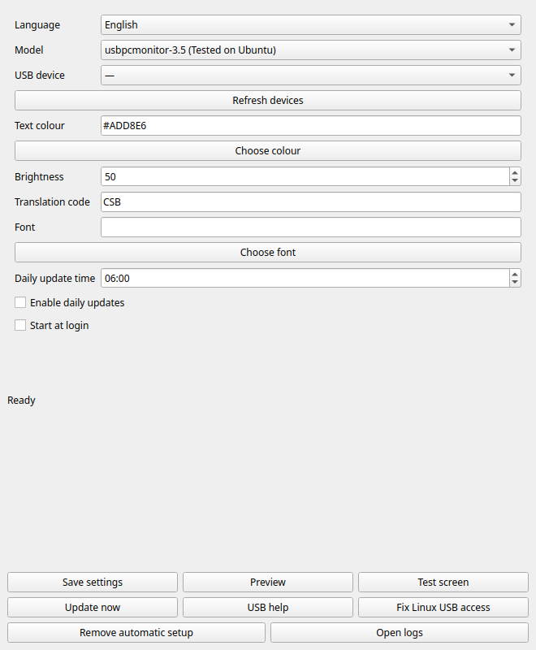

[English](README.md) · [简体中文](README.zh-CN.md) · [Español](README.es.md) · [Français](README.fr.md)

<div align="center">


# Bible Smart Display

**A daily Bible verse for your desk.**

For a **Turing Smart Screen 3.5-inch or similar** USB display.

These displays are also sold as **“IPS secondary screens”**, including on AliExpress. That listing name alone does not confirm compatibility; check the model table below.

[](https://github.com/dgcarr/bibleSmartDisplay/releases/latest)
[](https://github.com/dgcarr/bibleSmartDisplay/actions/workflows/desktop.yml)
[](LICENSE)

**Choose your translation · Light blue text · Adjustable brightness · Offline restore**


</div>

## The easiest way: download the app

**Recommended for almost everyone. Download a ready-made app—no Python, Git or terminal setup required.**

### [⬇ Open the latest release →](https://github.com/dgcarr/bibleSmartDisplay/releases/latest)

| Your computer | Download this file | Install |
| :--- | :--- | :--- |
| Windows 10/11 · x64 | `bibleSmartDisplay-windows-x64-setup.exe` | Run the installer |
| macOS 13+ · Apple Silicon | `bibleSmartDisplay-macos-arm64.dmg` | Open the DMG; drag the app to Applications |
| macOS 13+ · Intel | `bibleSmartDisplay-macos-x64.dmg` | Open the DMG; drag the app to Applications |
| Debian / Ubuntu · Intel/AMD | `biblesmartdisplay_0.4.4_amd64.deb` | Open with your software installer |
| Raspberry Pi OS / Debian / Ubuntu · ARM64 | `biblesmartdisplay_0.4.4_arm64.deb` | Open with your software installer |
| Other Linux desktops | `bibleSmartDisplay-linux-x64.tar.gz` / `bibleSmartDisplay-linux-arm64.tar.gz` | Extract and open the executable |

## Set up your screen

1. Connect your screen using a **USB data cable** and close any vendor display software.
2. Open **Bible Smart Display** from your applications menu. Follow the wizard to choose the screen model and USB port, set the colour and Bible translation, and send a test image.
3. Choose whether to enable **daily updates** and **Start at login**, then finish setup. Click **Update now** for your first verse.

**That’s it—you’re installed. You do not need to follow the source-installation instructions below.**

## Everyday settings

Use the tray/menu-bar icon to change model, colour, brightness, translation, font or interface language. English, Simplified Chinese, Spanish and French are included. Daily scheduling and startup each have their own checkbox. Quitting the tray leaves enabled scheduled updates running during your login session.

Text uses **3× supersampling** for smoother edges, while preserving the light lettering style. This applies to the desktop app, previews and scheduled updates on every supported model.

<details>
<summary>App screenshot</summary>



</details>

[Desktop guide, troubleshooting and removal](docs/desktop.md) · [Report an issue](https://github.com/dgcarr/bibleSmartDisplay/issues)

Requires a supported desktop OS. Builds are unsigned/not notarized; see the [desktop guide](docs/desktop.md) for compatibility and platform requirements. Before uninstalling, choose **Remove automatic setup** and quit the app.

## Choose your screen model

| Model option | Display | Landscape resolution | Status |
| :--- | :--- | :--- | :--- |
| `usbpcmonitor-3.5` | UsbPCMonitor / compatible 3.5-inch | 480 × 320 | Tested on Ubuntu; default |
| `turing-3.5` | Original Turing 3.5-inch | 480 × 320 | Experimental |
| `usbpcmonitor-5` | UsbPCMonitor 5-inch | 800 × 480 | Experimental |
| `usbpcmonitor-7` | UsbPCMonitor 7-inch | 1024 × 600 | Experimental |
| `xuanfang-3.5` | XuanFang Revision B / flagship | 480 × 320 | Experimental |
| `qiye-3.5` | Kipye / Qiye / 奇叶智显 (Revision D) | 480 × 320 | Experimental |

Select the exact model and serial port. **Experimental** means implemented and covered by simulated serial tests, but not physically tested by this project. These names describe protocols, not guaranteed seller brands.

**Not supported:** AX206/AIDA64/USB2LCD, Turing 5-inch Revision C, round screens, Waveshare USB-Monitor, GUITION, Fuldho/SmartMonitor and HDMI displays. AX206 needs a separate direct-USB backend, not a serial-driver switch. UsbPCMonitor 5-inch and Turing 5-inch are different protocols.

## USB drivers

**If your screen already appears as a serial port, try it before installing a driver.**

| Device / system | Official help or download |
| :--- | :--- |
| **Turing/TURZX screen** | [Manufacturer downloads](https://www.turzx.com/en/category/download/) — choose your exact model |
| **Windows USB CDC device** | [Microsoft’s built-in USB serial driver](https://learn.microsoft.com/en-us/windows-hardware/drivers/usbcon/usb-driver-installation-based-on-compatible-ids) — compatible devices install automatically |
| **Windows, confirmed CH340/CH341 chip** | [WCH Windows driver](https://www.wch.cn/downloads/CH341SER_EXE.html) |
| **macOS, supported WCH serial chip** | [WCH Mac driver and instructions](https://github.com/WCHSoftGroup/ch34xser_macos) |
| **Linux** | Compatible devices normally use the kernel’s existing serial drivers |

WCH drivers are **not universal screen drivers**. On Windows, check **Device Manager → Ports (COM & LPT)**. If the device has a warning icon, inspect **Properties → Details → Hardware Ids** and match the driver to that hardware. [Full driver guidance →](docs/setup.md#windows-usb-drivers)

---

<details>
<summary><strong>Optional: source installation and command-line tools (advanced users)</strong></summary>

**For developers and enthusiasts only. This is an alternative to the downloaded app, not the next installation step.** The commands below run the separate command-line edition. You can ignore this entire section when using the desktop app.

[Desktop app source / GUI](docs/desktop.md#build-from-source) · [CLI / Python](docs/setup.md#install-from-source-all-three-desktop-operating-systems)

Have your screen, a **USB data cable**, and an internet connection ready. Close any vendor display software before starting.

## Windows

### 1 · Download

Open **[the latest release](https://github.com/dgcarr/bibleSmartDisplay/releases/latest)**. Under **Assets**, choose **`bibleSmartDisplay-windows-x64.zip`**.

### 2 · Extract and connect

Extract the ZIP into a folder such as `Documents\bibleSmartDisplay`. Connect the screen to a USB data port.

### 3 · Run

Double-click **`Run-display.cmd`**. Your verse should appear on the screen.

The console stays open so you can read any messages. The app updates the screen once and exits; [set up a schedule](#update-it-every-morning) for daily updates.

<details>
<summary><strong>Screen not found? Select its COM port</strong></summary>

Open PowerShell in the extracted folder and run:

```powershell
.\bibleSmartDisplay.exe --list-ports
.\bibleSmartDisplay.exe --port COM3
```

Replace `COM3` with the port listed for your screen. If no port appears, see [USB drivers](#usb-drivers).

</details>

<details>
<summary><strong>Try it without a screen or internet connection</strong></summary>

```powershell
.\bibleSmartDisplay.exe --demo --preview-only
```

Open `%LOCALAPPDATA%\bibleSmartDisplay\preview.png` to see the test image.

</details>

> [!NOTE]
> The download is a portable console app, not a graphical installer. It is not code-signed. Windows build and preview tests pass; physical Windows/macOS USB testing is still needed. Physical output has been tested on Ubuntu.

## Linux

**1. Install the prerequisites:** Python 3.10+, Git, Python venv support and DejaVu Sans. On Ubuntu/Debian/Raspberry Pi OS, use your package manager to install `python3`, `python3-venv`, `python3-pip`, `git` and `fonts-dejavu-core`.

**2. Download and install:**

```sh
git clone https://github.com/dgcarr/bibleSmartDisplay.git
cd bibleSmartDisplay
python3 -m venv .venv
.venv/bin/python -m pip install -r requirements.txt
```

**3. Connect the screen and run:**

```sh
.venv/bin/python outputs/daily-verse/verse_display.py
```

If automatic detection fails, run with `--list-ports`, then `--port /dev/ttyACM0`, using your actual port. For permission errors, see [Linux serial access](docs/setup.md#linux-including-raspberry-pi-os).

## macOS

**1. Install [Python 3.10+](https://www.python.org/downloads/macos/).** Download this repository using **Code → Download ZIP**, then extract it.

**2. Open Terminal in the extracted folder** containing `requirements.txt` and run:

```sh
python3 -m venv .venv
.venv/bin/python -m pip install -r requirements.txt
```

**3. Connect the screen and run:**

```sh
.venv/bin/python outputs/daily-verse/verse_display.py
```

If automatic detection fails, run with `--list-ports`, then `--port /dev/cu.usbmodem1234`, replacing the example with your actual port. [More macOS help →](docs/setup.md#macos)

## Choose a translation

Use `--translation` with a [Bible Gateway version code](https://www.biblegateway.com/versions/):

```powershell
.\bibleSmartDisplay.exe --translation NIV
.\bibleSmartDisplay.exe --translation KJV
.\bibleSmartDisplay.exe --translation RVR1960
```

On Linux/macOS:

```sh
.venv/bin/python outputs/daily-verse/verse_display.py --translation NIV
```

CSB remains the default. Any single Bible Gateway text-version code can be requested; the passage must be available in that version. PDF/audio-only editions are not supported. Non-English text may need `--font` with a font covering that language; complex scripts and long unspaced passages are not fully tested.

Add the option to your scheduled task or edit the executable line in `Run-display.cmd` to keep using your choice. `--cached` restores the last saved translation; add `--translation NIV` to require that exact version. A failed lookup never silently replaces your requested translation with a different one. The cache still keeps only one passage.

## Make it yours

Defaults are **light blue text** and **50% brightness**. To change them, run from PowerShell:

```powershell
.\bibleSmartDisplay.exe --color "#ADD8E6" --brightness 50
```

For Linux/macOS, put the same options after `.venv/bin/python outputs/daily-verse/verse_display.py`.

| Option | What it does |
| :--- | :--- |
| `--brightness 25` | Dim the backlight; accepts 0–100 |
| `--color "#F5F5DC"` | Use beige text instead |
| `--cached` | Restore the last saved verse without internet |
| `--preview-only` | Save a preview without sending it to the screen |
| `--list-ports` | List connected serial devices |

Options apply to that run. Add them to your scheduled task to use them every day. [All settings and saved-file locations →](docs/setup.md#commands-and-settings)

## Update it every morning

Choose your operating system for step-by-step scheduling:

| Windows | Linux | macOS |
| :--- | :--- | :--- |
| [Task Scheduler](docs/setup.md#windows-task-scheduler) | [Cron](docs/setup.md#linux-cron) | [Launchd](docs/setup.md#macos-launchd) |

Your computer must be running and the screen connected. The first verse needs internet; later network failures fall back to the saved verse. The cache is overwritten, so it does not grow into a collection.

## Need help?

| Problem | First thing to try |
| :--- | :--- |
| Screen not found | Check the data cable, then `--list-ports` and [drivers](#usb-drivers) |
| Port busy | Close the vendor display app and other running copies |
| Wrong handshake or scrambled image | Check [hardware compatibility](docs/setup.md#compatible-displays) |
| No saved verse | Run once online without `--cached` |
| Window disappears | Launch with `Run-display.cmd` or from a terminal |

**[Full troubleshooting guide](docs/setup.md#troubleshooting)** · **[Report an issue](https://github.com/dgcarr/bibleSmartDisplay/issues)** · **[Build from source](docs/setup.md#build-the-windows-executable-yourself)**

When reporting a problem, include your OS, display model, hardware IDs and the error message.

</details>

### Credits & licence

Built with help from the [turing-smart-screen-python](https://github.com/mathoudebine/turing-smart-screen-python) protocol reference by Matthieu Houdebine and contributors. Independent of display manufacturers. Software: **[GPL v3](LICENSE)**; upstream files retain their own notices.

Daily reference: [Bible League](https://www.bibleleague.org/verse-of-the-day/). Passage text: [Bible Gateway](https://www.biblegateway.com/). Christian Standard Bible © 2017 Holman Bible Publishers. Scripture is not covered by the software licence.
