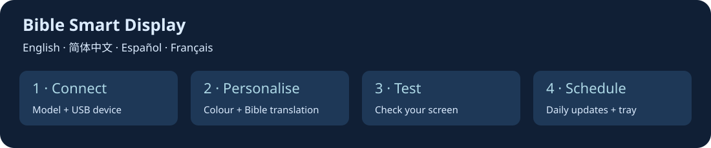

[English](README.md) · [简体中文](README.zh-CN.md) · [Español](README.es.md) · [Français](README.fr.md)


# Bible Smart Display

**让每日经文常伴你的书桌。**

适用于 **Turing Smart Screen 3.5 英寸或类似的 USB 智能屏幕**。

在 AliExpress 等平台，这类产品也常以 **“IPS secondary screen”（IPS 副屏）** 的名称销售。商品名称不能保证兼容性，请确认下方的型号列表。

[下载 Windows 版](https://github.com/dgcarr/bibleSmartDisplay/releases/latest) · [构建状态](https://github.com/dgcarr/bibleSmartDisplay/actions/workflows/windows.yml) · [GPL v3](LICENSE)

**可选译本 · 浅蓝色文字 · 可调亮度 · 离线恢复**

本程序读取 [Bible League 的每日经文出处](https://www.bibleleague.org/verse-of-the-day/)，从 Bible Gateway 获取所选译本的经文（默认 **CSB**），再显示到屏幕上。字号会根据内容自动调整。

## 选择屏幕型号

| 型号参数 | 屏幕 | 横屏分辨率 | 状态 |
| :--- | :--- | :--- | :--- |
| `usbpcmonitor-3.5` | UsbPCMonitor / compatible 3.5-inch | 480 × 320 | 已在 Ubuntu 实机测试；默认 |
| `turing-3.5` | Original Turing 3.5-inch | 480 × 320 | 实验性 |
| `usbpcmonitor-5` | UsbPCMonitor 5-inch | 800 × 480 | 实验性 |
| `usbpcmonitor-7` | UsbPCMonitor 7-inch | 1024 × 600 | 实验性 |
| `xuanfang-3.5` | XuanFang Revision B / flagship | 480 × 320 | 实验性 |
| `qiye-3.5` | Kipye / Qiye / 奇叶智显 (Revision D) | 480 × 320 | 实验性 |

请指定准确型号和串口。**实验性**表示已实现并通过模拟串口测试，但本项目尚未进行对应硬件的实机验证。商品名称不能保证协议兼容。

```powershell
.\bibleSmartDisplay.exe --list-models
.\bibleSmartDisplay.exe --model xuanfang-3.5 --port COM3
.\bibleSmartDisplay.exe --model turing-3.5 --port COM3
```

Linux/macOS 将相同参数添加到 `.venv/bin/python outputs/daily-verse/verse_display.py` 后面。实验性型号必须显式指定 `--port`。使用 `--demo --preview-only` 可在不连接硬件时预览布局。

仅显式选择 `turing-3.5` 时允许 HELLO 无响应；UsbPCMonitor 必须返回对应尺寸的响应。不要用原版 Turing 选项绕过未知设备错误。部分 XuanFang 版本只支持背光开关；本程序不配置 RGB 背板。Qiye 没有身份握手，必须正确选择设备。

**仍不支持：** AX206/AIDA64/USB2LCD、Turing 5 英寸 Revision C、圆屏、Waveshare USB-Monitor、GUITION、Fuldho/SmartMonitor 和 HDMI 显示器。AX206 需要单独的直接 USB 后端。UsbPCMonitor 5 英寸与 Turing 5 英寸协议不同。

## 选择安装方式

| 系统 | 安装方式 |
| :--- | :--- |
| Windows 10/11 x64 | 下载便携版，无需安装 Python |
| Linux / Raspberry Pi OS | 使用 Python 3.10 或更新版本运行源码 |
| macOS | 使用 Python 3.10 或更新版本运行源码 |

请准备好屏幕、**支持数据传输的 USB 线**和网络连接。运行前关闭厂商自带的屏幕软件。

## Windows：三步开始

1. 打开[最新发布页面](https://github.com/dgcarr/bibleSmartDisplay/releases/latest)，在 **Assets** 下下载 `bibleSmartDisplay-windows-x64.zip`，不要选择源码 ZIP。
2. 解压到自己的文件夹，例如 `Documents\bibleSmartDisplay`，然后连接屏幕的数据接口。
3. 双击 **`Run-display.cmd`**。程序更新一次屏幕后退出，控制台会保留运行信息。

<details>
<summary><strong>找不到屏幕？手动选择 COM 端口</strong></summary>

在解压目录打开 PowerShell：

```powershell
.\bibleSmartDisplay.exe --list-ports
.\bibleSmartDisplay.exe --port COM3
```

把 `COM3` 替换为实际端口。如果没有列出端口，请查看下方驱动说明。

</details>

<details>
<summary><strong>没有屏幕或网络也能预览</strong></summary>

```powershell
.\bibleSmartDisplay.exe --demo --preview-only
```

打开 `%LOCALAPPDATA%\bibleSmartDisplay\preview.png` 查看测试图片。

</details>

> [!NOTE]
> Windows 下载版是未签名的便携式控制台程序，并非图形化安装程序。已通过 Windows 自动构建和预览测试；Windows/macOS 实机 USB 测试仍待完成。已在 Ubuntu 上验证实机显示。

## Linux

先安装 Python 3.10+、Git、venv 支持和 DejaVu Sans 字体。Ubuntu/Debian/Raspberry Pi OS 对应软件包为 `python3`、`python3-venv`、`python3-pip`、`git` 和 `fonts-dejavu-core`。

```sh
git clone https://github.com/dgcarr/bibleSmartDisplay.git
cd bibleSmartDisplay
python3 -m venv .venv
.venv/bin/python -m pip install -r requirements.txt
.venv/bin/python outputs/daily-verse/verse_display.py
```

自动识别失败时，添加 `--list-ports` 查看端口，再用 `--port /dev/ttyACM0` 指定实际端口。权限问题请参阅 [Linux 串口访问说明（英文）](docs/setup.md#linux-including-raspberry-pi-os)。

## macOS

安装 [Python 3.10+](https://www.python.org/downloads/macos/)。在本仓库点击 **Code → Download ZIP**，解压后在包含 `requirements.txt` 的目录打开终端：

```sh
python3 -m venv .venv
.venv/bin/python -m pip install -r requirements.txt
.venv/bin/python outputs/daily-verse/verse_display.py
```

自动识别失败时先用 `--list-ports`，再添加 `--port /dev/cu.usbmodem1234`，并替换为实际端口。[macOS 帮助（英文）](docs/setup.md#macos)

## USB 驱动

**如果屏幕已显示为可用串口，请先尝试运行，无需急于安装驱动。**

| 设备 / 系统 | 官方资源 |
| :--- | :--- |
| Turing/TURZX 屏幕 | [厂商下载页](https://www.turzx.com/en/category/download/)，请选择对应型号 |
| Windows USB CDC 设备 | [微软内置 USB 串口驱动说明](https://learn.microsoft.com/en-us/windows-hardware/drivers/usbcon/usb-driver-installation-based-on-compatible-ids)，兼容设备可自动安装 |
| Windows，已确认采用 CH340/CH341 | [WCH Windows 驱动](https://www.wch.cn/downloads/CH341SER_EXE.html) |
| macOS，受支持的 WCH 串口芯片 | [WCH macOS 驱动及安装说明](https://github.com/WCHSoftGroup/ch34xser_macos) |
| Linux | 兼容设备通常使用内核自带串口驱动 |

WCH 驱动**不是通用屏幕驱动**。Windows 中打开“设备管理器 → 端口 (COM 和 LPT)”。若有警告图标，在“属性 → 详细信息 → 硬件 ID”中确认型号，再选择对应驱动。[完整驱动说明（英文）](docs/setup.md#windows-usb-drivers)

## 选择圣经译本

使用 [Bible Gateway 译本代码](https://www.biblegateway.com/versions/)：

```powershell
.\bibleSmartDisplay.exe --translation NIV
.\bibleSmartDisplay.exe --translation KJV
```

Linux/macOS 示例：

```sh
.venv/bin/python outputs/daily-verse/verse_display.py --translation NIV
```

默认译本仍为 CSB。可以指定一个 Bible Gateway 文本译本代码，但该译本必须包含所请求的经文。不支持仅提供 PDF 或音频的版本。

**中文显示说明：** 中文 README 不代表中文经文排版已完成验证。显示中文时，需要用 `--font` 指定包含中文字形的字体；当前按空格换行，较长且无空格的中文段落可能无法排版。复杂文字和无空格长段落仍需进一步测试。

参数不会自动保存。要持续使用某个译本，请将参数加入计划任务，或修改 `Run-display.cmd` 中调用程序的那一行。`--cached` 恢复最近保存的译本；同时添加 `--translation NIV` 可要求缓存必须为 NIV。获取失败不会悄悄改用其他译本，缓存始终只保留一段经文。

## 调整外观

默认为**浅蓝色文字、50% 亮度**：

```powershell
.\bibleSmartDisplay.exe --color "#ADD8E6" --brightness 50
```

Linux/macOS 将相同参数放在 `.venv/bin/python outputs/daily-verse/verse_display.py` 后面。

| 参数 | 用途 |
| :--- | :--- |
| `--brightness 25` | 设置背光，范围 0–100 |
| `--color "#F5F5DC"` | 改为米色文字 |
| `--cached` | 离线恢复最近保存的经文 |
| `--preview-only` | 只生成预览，不向屏幕发送图片 |
| `--list-ports` | 列出串口设备 |

参数仅对本次运行生效。需要每日使用时，请加入计划任务。[全部设置和文件位置（英文）](docs/setup.md#commands-and-settings)

## 每日自动更新

程序每次只更新一次；自动每日更新需要设置系统计划任务：

[Windows 任务计划程序（英文）](docs/setup.md#windows-task-scheduler) · [Linux cron（英文）](docs/setup.md#linux-cron) · [macOS launchd（英文）](docs/setup.md#macos-launchd)

电脑必须运行且屏幕已连接。首次获取需要网络；之后网络故障时可使用同译本的已保存经文。缓存会覆盖，不会不断积累。

## 遇到问题？

| 问题 | 先检查 |
| :--- | :--- |
| 找不到屏幕 | 数据线、`--list-ports` 和 USB 驱动 |
| 端口被占用 | 关闭厂商软件及其他运行实例 |
| 握手错误或画面错乱 | 确认型号、尺寸和协议兼容性 |
| 没有缓存经文 | 联网运行一次，不加 `--cached` |
| 窗口一闪而过 | 使用 `Run-display.cmd` 或在终端运行 |

[完整排错指南（英文）](docs/setup.md#troubleshooting) · [提交问题](https://github.com/dgcarr/bibleSmartDisplay/issues) · [自行构建（英文）](docs/setup.md#build-the-windows-executable-yourself)

提交问题时请提供操作系统、屏幕型号、硬件 ID 和错误信息。

---

## 桌面应用：引导设置和托盘控制

**English · 简体中文 · Español · Français** — 在设置中选择界面语言。桌面应用提供型号和 USB 端口选择、文字颜色、亮度、圣经译本、离线预览和每日自动更新。打包版本不需要安装 Python。



| 系统 | 下载文件 |
| :--- | :--- |
| Windows 10/11 x64 | `bibleSmartDisplay-windows-x64-setup.exe` |
| macOS 13+，Intel / Apple Silicon | `bibleSmartDisplay-macos-x64.dmg` / `bibleSmartDisplay-macos-arm64.dmg` |
| Linux x64 / 64 位树莓派 | `bibleSmartDisplay-linux-x64.tar.gz` / `bibleSmartDisplay-linux-arm64.tar.gz` |

[下载桌面版本](https://github.com/dgcarr/bibleSmartDisplay/releases) · [详细指南（英文）](docs/desktop.md)

1. Windows 运行安装程序；Mac 将应用拖入“应用程序”；Linux 解压后运行 `./BibleSmartDisplay --install` 打开图形安装程序，也可使用系统支持的 `Install.desktop` 启动器。
2. 选择准确型号和 USB 端口，设置颜色、亮度和译本，并发送测试图像。
3. 启用每日更新和登录启动。默认时间为当地 06:00，CSB 译本、浅蓝色文字、50% 亮度。

退出托盘应用后，登录期间的计划更新仍会运行；重新连接检测需要应用保持运行。卸载前在设置中选择“移除自动设置”。Linux 权限修复会显示管理员认证窗口；部分设备可能需要厂商 USB 驱动。界面语言与圣经译本分别设置，中文经文还需支持中文的字体。

初始版本未进行发布者签名或 Apple 公证。只有连接的 Ubuntu 3.5 英寸型号经过实机验证，其他型号或系统的硬件状态请参阅兼容性说明。Linux 目标为 Debian 12+、Ubuntu 24.04+ 和 64 位 Raspberry Pi OS Bookworm+，需要图形桌面和 systemd 用户服务。

**以下为独立命令行版本的说明。** 如果某个发行版还没有桌面文件，请选择包含这些文件的发行版或参照桌面指南从源代码构建。


### 致谢与许可

本项目参考 Matthieu Houdebine 及贡献者维护的 [turing-smart-screen-python](https://github.com/mathoudebine/turing-smart-screen-python) 协议实现，与屏幕厂商无隶属关系。软件采用 **[GPL v3](LICENSE)**；上游文件保留其原有版权声明。

每日出处来自 [Bible League](https://www.bibleleague.org/verse-of-the-day/)，经文来自 [Bible Gateway](https://www.biblegateway.com/)。默认 CSB 译本：Christian Standard Bible © 2017 Holman Bible Publishers。其他译本的版权归相应权利人所有；经文不受本软件许可证覆盖。
